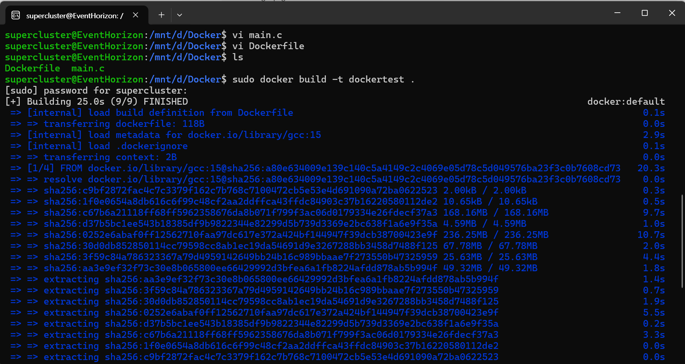
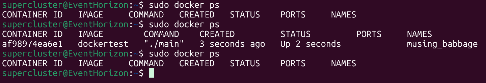
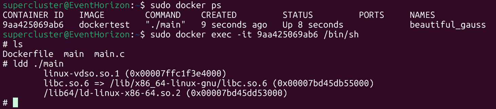
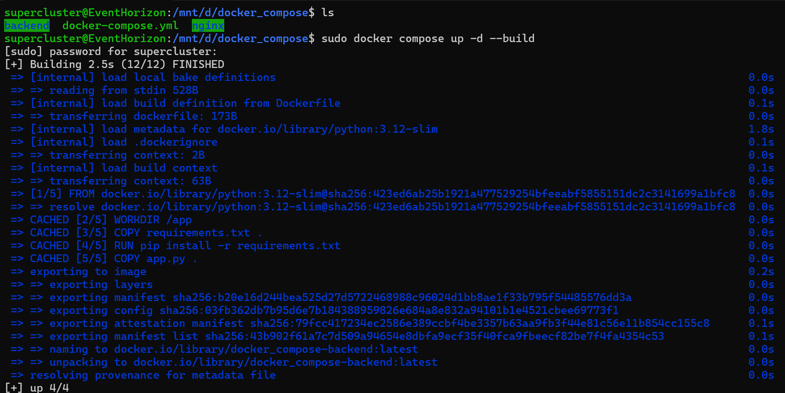
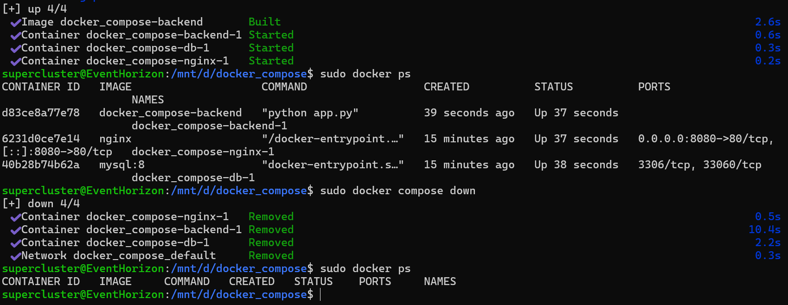

# Docker 도커 기초

### **Docker란 무엇이며, 왜 사용하는가?**

 Docker는 컨테이너 기반의 가상화 도구로, 자신의 로컬 시스템과 다른 환경을 만들어 그 속에서 프로그램이 동작할 수 있도록 하는 시스템이다. Ubuntu, Windows와 같은 OS에 따라서, Python, Java, C와 같은 프로그래밍 언어의 버전에 따라서 명령어, 라이브러리 등의 차이가 생기기 때문에, 동일한 프로그램도 환경에 따라 다르게 동작하거나 동작하지 않을 가능성이 있다. 예를 들어, Windows 11 환경에서 Python 3.12 버전으로 특정 라이브러리를 활용해 프로그램을 개발해 다른 사람에게 전달했다고 하자. 하지만 그 사람은 다른 운영체제에서 Python 3.8 버전을 사용하고 있었고, 라이브러리도 설치되지 않은 상황일 수 있다. 이 경우 프로그램이 실행되지 않을 수 있고, 실행되도록 하기 위해 전달받은 사람이 버전을 업데이트하고, 라이브러리를 따도 설치하고, 심한 경우 운영체제마저 바꿔야 하는 불편한 상황이 발생할 수 있다. Docker 컨테이너는 이와 같은 문제를 해결해주는 도구로, 프로그램과 그 프로그램의 실행에 필요한 환경까지 함께 구성하고, 이를 다른 컴퓨터에서도 재현할 수 있도록 만들어준다. 
 이미지는 컨테이너를 생성하기 위한 템플릿이고, 컨테이너는 그 이미지를 이용하여 생성된 실행 환경이다. Dockerfile은 이미지를 만들기 위한 명령어들을 작성해 놓은 파일으로, 이를 통해 이미지를 만들 수 있다. Dockerfile에는 기반이 될 환경, 작업할 디렉토리, 설치할 라이브러리, 컨테이너 실행 시 수행할 명령 등을 포함된다.

### **Docker 설치**

```bash
sudo apt-get install ca-certificates curl gnupg
sudo install -m 0755 -d /etc/apt/keyrings
curl -fsSL https://download.docker.com/linux/ubuntu/gpg | sudo gpg --dearmor -o /etc/apt/keyrings/docker.gpg
sudo chmod a+r /etc/apt/keyrings/docker.gpg

echo \
  "deb [arch="$(dpkg --print-architecture)" signed-by=/etc/apt/keyrings/docker.gpg] https://download.docker.com/linux/ubuntu \
  "$(. /etc/os-release && echo "$VERSION_CODENAME")" stable" | \
  sudo tee /etc/apt/sources.list.d/docker.list > /dev/null

sudo apt-get update
```

```bash
sudo apt-get install docker-ce docker-ce-cli containerd.io docker-buildx-plugin docker-compose-plugin
```

```bash
sudo service docker start
sudo docker run hello-world
```

### **Docker 이미지 빌드**

문자열을 입력받고 그대로 출력하는 간단한 C 프로그램과 Dockerfile을 작성했다.

```c
#include <stdio.h>
int main(){
	char str[0x30];
	scanf("%s", str);
	printf("%s", str);
	return 0;
}
```

```docker
FROM gcc:15
WORKDIR /app
COPY . .
RUN gcc main.c -o main
CMD ["./main"]
```

`sudo docker build -t dockertest .` 를 입력해 이미지 빌드를 완료하고, `sudo docker run --rm -it dockertest` 를 입력해 터미널로 C 프로그램 입력을  받을 수 있도록 실행했다.



`sudo docker ps`로 확인한 결과, 실행 후 입력을 받기 전까지는 ps에서 실행 중인 것으로 확인이 되고 입력을 받아 프로그램이 종료되면 컨테이너도 삭제되어 ps로 확인이 되지 않았다. 



`sudo docker ps`로 container id를 확인하고, `sudo docker exec -it <container_id> /bin/sh`로 컨테이너 내부 쉘에 접속했다. `ldd ./main`으로 libc 경로까지 확인했다.



### **Docker compose 멀티 컨테이너**

nginx, python flask, mysql로 구성된 웹 멀티 컨테이너를 구성했다.

```yaml
services:
  nginx:
    image: nginx
    ports:
      - "8080:80"
    volumes:
      - ./nginx/default.conf:/etc/nginx/conf.d/default.conf
    depends_on:
      - backend
  backend:
    build: ./backend
    depends_on:
      - db
  db:
    image: mysql:8
    environment:
      MYSQL_ROOT_PASSWORD: root
      MYSQL_DATABASE: test
```

```
server{
	listen 80;
	location / {
	proxy_pass http://backend:5000;
	}
}
```

```docker
FROM python:3.12-slim
WORKDIR /app
COPY requirements.txt .
RUN pip install -r requirements.txt
COPY app.py .
CMD ["python", "app.py"]
```

```python
from flask import Flask
import mysql.connector

app = Flask(__name__)

@app.route("/")
def home():
    return "Hello Compose"

@app.route("/db")
def db():
    conn = mysql.connector.connect(
        host="db",
        user="root",
        password="root",
        database="test"
    )

    conn.close()

    return "DB Connected"

app.run(
    host="0.0.0.0",
    port=5000
)
```

```
flask
mysql-connector-python
```

`sudo docker compose up -d --build`로 웹 멀티 컨테이너 환경을 빌드했다.



`sudo docker ps`로 모든 컨테이너가 잘 열려있음을 확인했고, 웹으로 localhost:8080에 접속한 결과 화면이 잘 보임을 확인했다. `sudo docker compose down`으로 종료하고, `sudo docker ps`를 다시 확인한 결과 컨테이너가 모두 닫힌 것을 확인할 수 있었다. 

